

  

### AI 

React · Next.js · TypeScript로 웹을 만들고, 새로운 인터랙션과 도구를 실험합니다.

 

## ⚡ Tech playground

  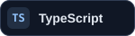
  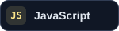
  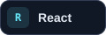
  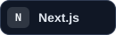
  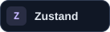
  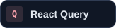

컴포넌트부터 상태 관리까지, 사용자와 맞닿는 경험을 만듭니다.

 

## ✦ Selected projects

웹 서비스부터 크리에이티브 도구까지. 카드를 누르면 저장소로 이동합니다.

  <a href="https://github.com/dearyour/hyperframe-reference-studio">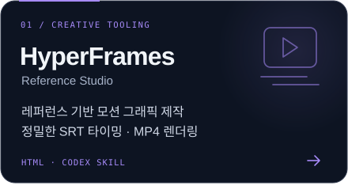</a>
  <a href="https://github.com/jobko-food-map/jobko-food-map-fe">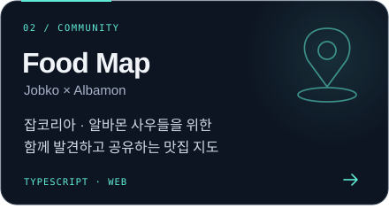</a>
  <a href="https://github.com/dearyour/Seonbee">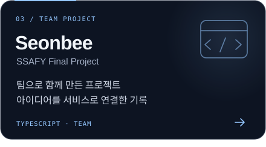</a>
  <a href="https://github.com/dearyour/ondo">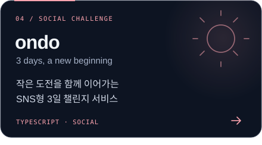</a>

 

## ↗ Notes &amp; connections

개발하며 배운 것과 고민한 과정을 기록합니다.

**[Velog · 개발 기록 읽기 →](https://velog.io/@dear/)**

 

  

